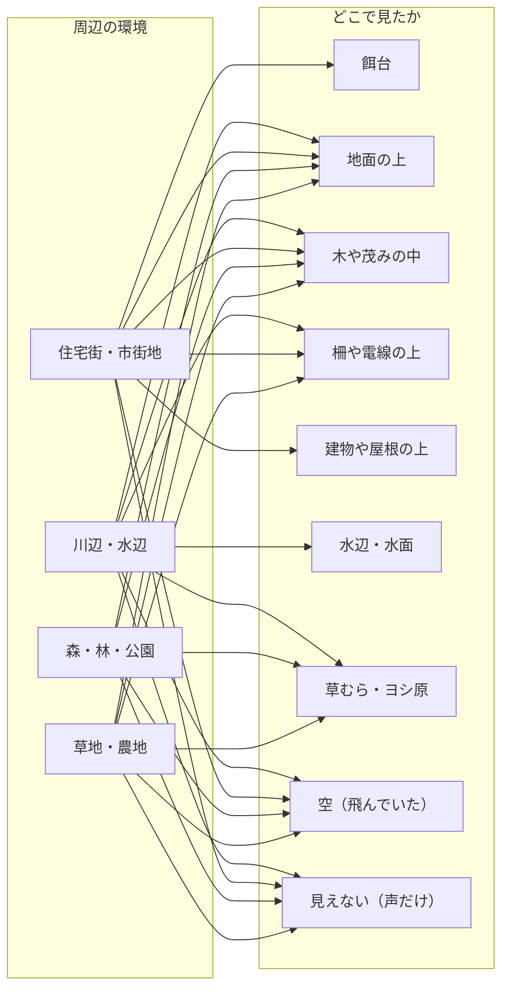
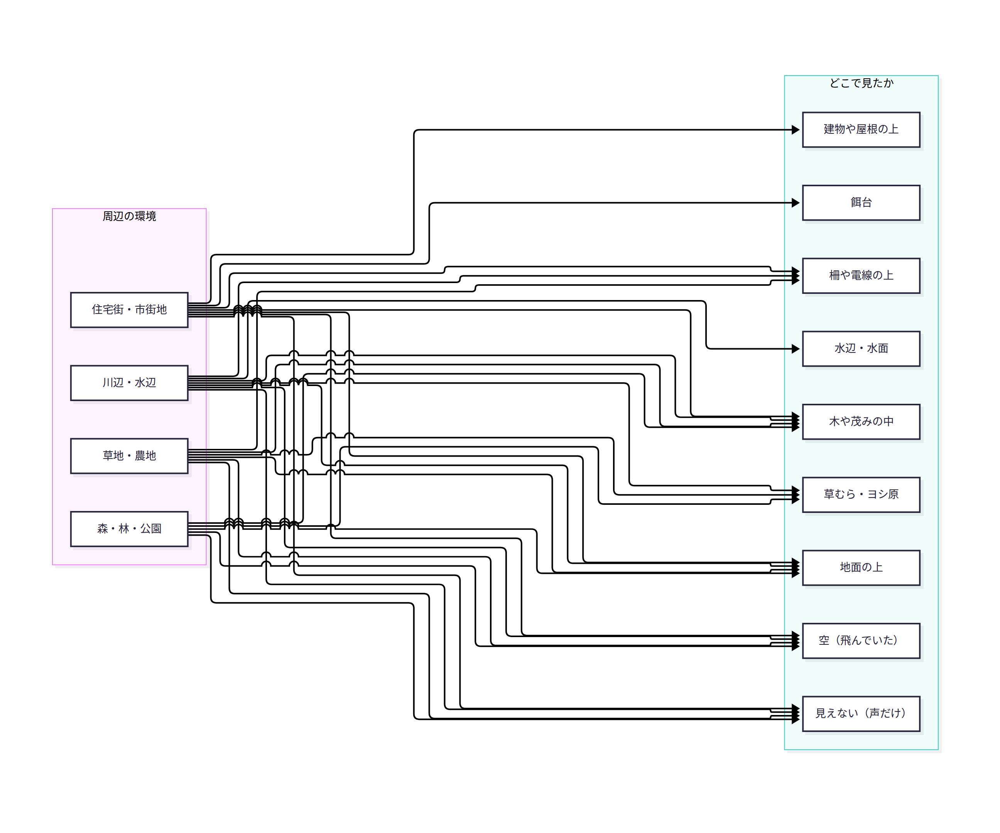
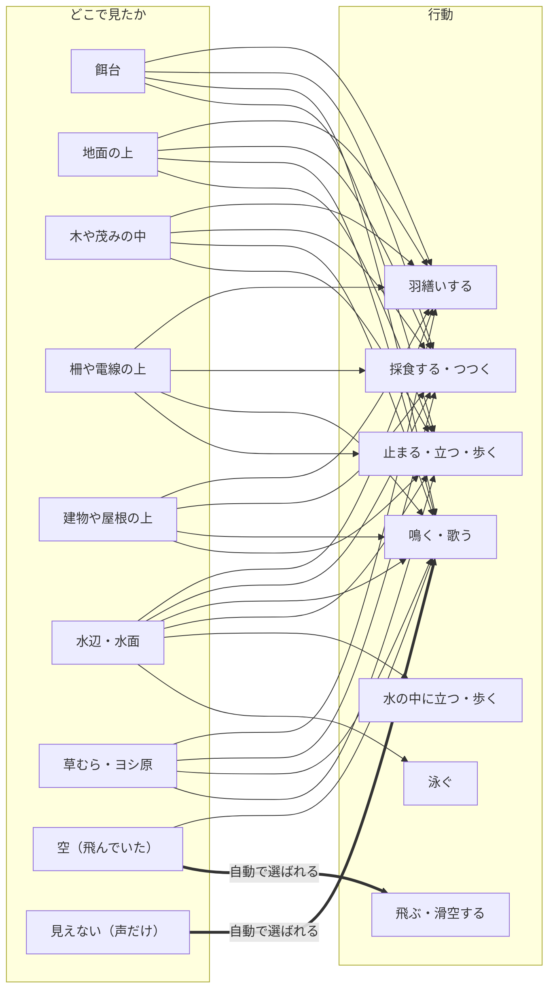
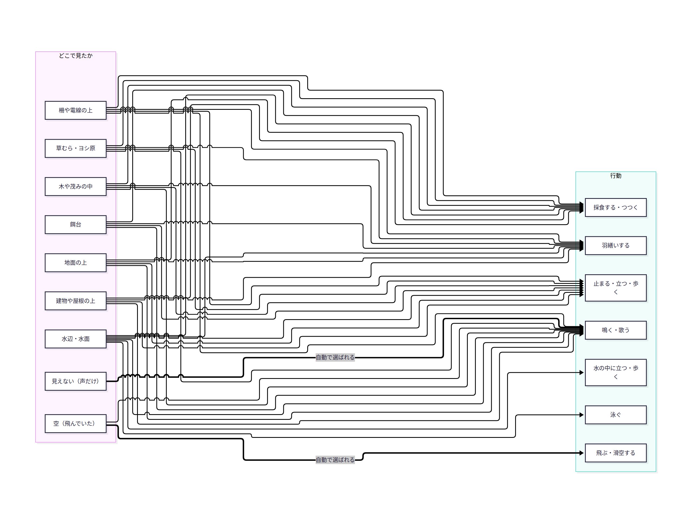
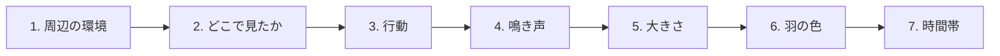
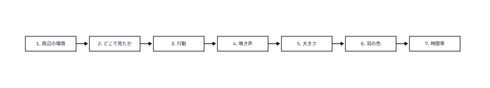
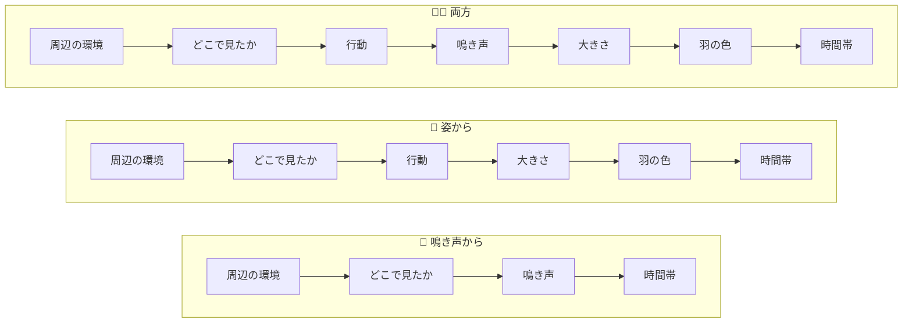
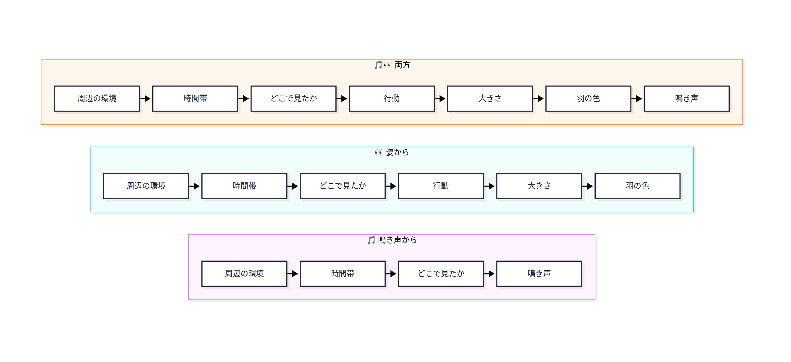

# 条件入力の選択肢ツリー

「探す」タブで入力する条件の選択肢と、前の回答による絞り込みの規則を図にまとめる。
規則の正本は`frontend/src/domain/choices.ts`である。
1〜4番目の図は、そのコードから自動生成した文字列と一致することをテストで確認している。
規則を変えて図を直し忘れると、テストが失敗する。

## 絞り込みの原則

- 周辺の環境を選ぶと、「どこで見たか」はその環境にあり得る場所だけになる
- 「飛ぶ」は場所が「空」のときだけ出る。空を選ぶと自動で選ばれる
- 「見えない（声だけ）」を選ぶと、行動は「鳴く・歌う」だけになり、自動で選ばれる
- 「泳ぐ」「水の中に立つ・歩く」は、水辺・水面のとき（場所が未選択なら水辺の環境）だけ出る
- 「見えない」は場所の手がかりにならないため、場所のスコアは加点も減点もしない
- 「見えない」のときは、大きさ・羽の色は回答不要なので、そのカードを出さない（入力済みの値も消す）

## 1. 周辺の環境 → どこで見たか

図を表示

## 2. どこで見たか → 行動

太い矢印は、場所を選ぶと自動で選ばれる行動。

図を表示

## 3. 入力カードの流れ

図を表示

## 4. 入口（鳴き声から／姿から／両方）

画面の上部で、何をもとに探すかを選ぶ。出すカードが変わる（既定は「両方」）。
出さないカードの項目は、入力済みでも判定に使わない（未入力と同じ扱い）。値は消さずに保持するので、切り替えて戻すと効く。
この図は、`choices.ts`の`ENTRY_STEPS`から自動生成した文字列と一致することをテストで確認している。

図を表示

